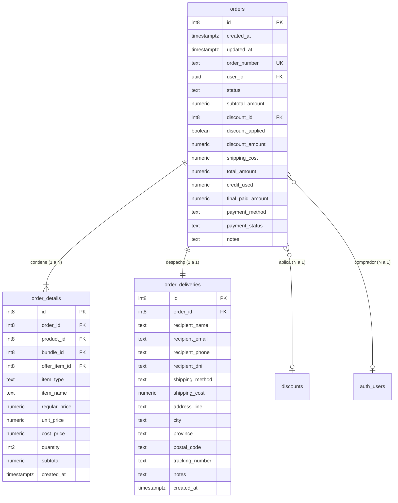

# Especificación Técnica: Módulo de Pedidos y Ventas (`orders`, `order_details` & `order_deliveries`)

Este documento constituye la **Hoja de Requisitos y Especificación de Arquitectura** para el módulo de administración de pedidos en el Backoffice de EcoTanti.

---

## 1. Alcance y Objetivos

El módulo de Pedidos es el núcleo operativo del e-commerce: centraliza todas las compras realizadas por los clientes, permite trazar la preparación y despacho, gestionar la cobranza y recibir alertas en vivo sin necesidad de recargar la página.

---

## 2. Modelo de Datos y Relaciones

El módulo opera sobre 3 tablas relacionales en PostgreSQL (Supabase):



### 2.1. Estados Operativos (`status`)
| Código | Etiqueta | Color / Badge | Descripción |
|---|---|---|---|
| `pending` | **Pendiente** | Ámbar (`warn`) | Orden recién creada, pendiente de revisión inicial. |
| `preparing` | **En Preparación** | Azul (`info`) | Pedido aceptado y siendo empacado en depósito. |
| `ready_for_pickup` | **Listo para Retirar** | Púrpura (`secondary`) | Pedido listo para que el cliente retire en el local. |
| `shipped` | **Enviado** | Cian (`info`) | Pedido despachado por correo o mensajería con tracking. |
| `delivered` | **Entregado** | Esmeralda (`success`) | Pedido finalizado y entregado al destinatario. |
| `cancelled` | **Cancelado** | Carmesí (`danger`) | Pedido anulado (requiere confirmación obligatoria). |

### 2.2. Estados Financieros (`payment_status`) - 100% Independientes
| Código | Etiqueta | Badge | Descripción |
|---|---|---|---|
| `pending` | **Pago Pendiente** | Ámbar | Aún no se ha verificado el pago o acreditación bancaria. |
| `completed` | **Pagado / Acreditado** | Esmeralda | Pago confirmado por pasarela o transferencia bancaria manual. |
| `failed` | **Fallido** | Carmesí | Rechazo de tarjeta o error de procesamiento. |
| `refunded` | **Reembolsado** | Pizarra | Devolución total o parcial realizada al cliente. |

---

## 3. Arquitectura en Tiempo Real y Notificaciones

### 3.1. Supabase Realtime (`orders`)
- Se suscribe un canal WebSocket de Supabase en `OrdersService`:
  ```typescript
  supabase
    .channel('orders-realtime')
    .on('postgres_changes', { event: '*', schema: 'public', table: 'orders' }, (payload) => ...)
    .subscribe();
  ```
- **Evento `INSERT` (Nuevo Pedido):**
  1. **Sonido de Alerta:** Reproducción de un chime sonoro breve (`new-order.mp3`).
  2. **Toast In-App:** Notificación flotante de PrimeNG: `¡Nuevo Pedido #ORD-2026-X por $Y recibido!`.
  3. **PWA / Notificación del Sistema:** Emisión mediante `Notification API` en el dispositivo móvil o escritorio:
     `new Notification('Nuevo Pedido EcoTanti', { body: 'Orden #ORD-2026-X de Juan Pérez por $15.000', icon: '/icons/icon-192.png' })`.
  4. **Contador en el Header:** Incremento del badge en la campana de notificaciones.
  5. **Actualización de la Tabla:** Incorporación instantánea de la fila en la cima con efecto de resalte visual (*flash highlight*).
- **Evento `UPDATE` (Actualización de Pedido):**
  - Sincronización automática de la fila afectada en la tabla y en el panel lateral si estuviera abierto.

### 3.2. Campana de Notificaciones en el Header (`HeaderComponent`)
- Ubicada en la barra superior junto al botón de Cerrar Sesión.
- Muestra un badge numérico dinámico con la cantidad de pedidos nuevos o pendientes.
- Al hacer clic, navega directamente a `/pedidos` y resalta los pedidos no revisados.

---

## 4. Diseño de la Interfaz de Usuario (UI/UX Desktop)

### 4.1. Barra de Herramientas Superior
- **Buscador Global Multicriterio:** Busca simultáneamente por:
  - Número de orden (`ORD-2026-001`)
  - Nombre del destinatario (`recipient_name`)
  - Email (`recipient_email`)
  - Teléfono (`recipient_phone`)
  - Dirección (`address_line`, `city`)
- **Paginador Optimus UI:**
  - Control de páginas (`<< < 1 2 3 4 5 > >>`).
  - Selector de filas por página: `5`, `10`, `20`, `50` (según captura de referencia).
  - Contador: *"Mostrando 1 a 10 de 45 pedidos"*.
- **Botón de Refresco Manual:** Para sincronizar manualmente en caso de microcortes de red.

### 4.2. Tabla de Datos Avanzada (`p-table`)
Cada fila representa un pedido y cuenta con las siguientes columnas optimizadas:

| Columna | Tipo de Contenido | Filtro Integrado en Encabezado |
|---|---|---|
| **Pedido** | `#ORD-2026-001` (bold font-mono) + fecha/hora | Búsqueda por texto |
| **Cliente** | Nombre completo + Teléfono | Búsqueda por texto |
| **Envío** | Badge de método (Retiro, Envío Local, Nacional) | Menú Dropdown (Retiro / Envío) |
| **Pago** | Badge de estado de cobro + Método | Menú Dropdown (Pendiente / Pagado / etc.) |
| **Total** | Monto final `$15.000,00` + cantidad de ítems | Rango numérico / ordenamiento |
| **Estado** | **Dropdown selector en vivo** (cambio rápido) | Menú Dropdown con multiselect |
| **Acciones** | Botón 'Ver Detalle' (ícono ojo / panel lateral) | - |

#### Interacción del Dropdown de Estado en la Fila:
- Muestra el estado actual con su color característico.
- Al desplegar y seleccionar un nuevo estado operativo:
  - Si es un estado normal (`preparing`, `shipped`, `ready_for_pickup`, `delivered`): actualización en segundo plano instantánea + Toast de confirmación.
  - Si se elige `cancelled`: abre modal de seguridad para confirmar la anulación.

---

### 4.3. Panel Lateral Deslizable (Drawer de Detalle Completo)
Al tocar una fila o pulsar *Ver Detalle*, se abre un panel lateral derecho (`p-drawer` / drawer contextual) sin tapar la tabla:

1. **Cabecera del Pedido:**
   - Número de orden, fecha y hora exacta de creación.
   - Selectores independientes para cambiar `Estado del Pedido` y `Estado del Pago`.
2. **Datos del Comprador y Destinatario:**
   - Nombre, DNI, Email, Teléfono con botón directo *"Enviar WhatsApp"*.
3. **Logística y Entrega:**
   - Método seleccionado: *Retiro en Local*, *Envío a Domicilio*.
   - Dirección completa (Calle, Ciudad, Provincia, Código Postal).
   - Campo editable para el **Número de Seguimiento (Tracking)** con botón de guardado rápido.
4. **Composición del Pedido (Ítems comprados):**
   - Lista detallada de productos y combos con miniaturas.
   - Cantidad adquirida, precio unitario de lista, precio cobrado en oferta/descuento y subtotal por línea.
5. **Desglose Contable:**
   - Subtotal de productos.
   - Descuentos aplicados (código de cupón o descuento por mayor).
   - Costo de envío.
   - Créditos / puntos usados.
   - **Total Final Facturado / Cobrado**.
6. **Notas y Observaciones:**
   - Notas dejadas por el cliente al momento de comprar.
   - Notas internas del operador de depósito.

---

## 5. Permisos y Navegación

- **Menú Lateral (`drawer.html`):**
  - Nueva sección: **`Ventas`** (ícono `pi pi-shopping-bag`).
  - Enlace: **`Pedidos`** (ruta `/pedidos`).
- **Control de Permisos:**
  - Ver listado y detalles: `orders.view`.
  - Modificar estados, pagos o tracking: `orders.manage`.

---

## 6. Checklist de Implementación

- [ ] **Fase 1: Servicio de Órdenes y Realtime (`shared-catalog`)**
  - Crear `OrdersService` en `libs/shared-catalog/src/lib/services/orders.service.ts`.
  - Implementar métodos: `getOrders()`, `getOrderById()`, `updateOrderStatus()`, `updatePaymentStatus()`, `updateTrackingNumber()`.
  - Configurar canal Supabase Realtime con callbacks reactivos.
  - Exportar servicio y modelos en `libs/shared-catalog/src/index.ts`.
- [ ] **Fase 2: Notificaciones en Header y PWA**
  - Añadir ícono de campana con contador en `HeaderComponent` (`projects/backoffice`).
  - Crear servicio de notificaciones sonoras y `Notification API` para PWA.
- [ ] **Fase 3: Vista Principal de Pedidos (`OrdersComponent`)**
  - Crear componente en `features/sales/orders/orders.ts` y `orders.html`.
  - Integrar `p-table` con filtros de columna, buscador global y paginador Optimus UI.
  - Implementar dropdown interactivo de cambio de estado en vivo en la fila.
  - Diálogo de confirmación para estado Cancelado.
- [ ] **Fase 4: Panel Lateral de Detalle (`OrderDetailDrawerComponent`)**
  - Crear drawer en `components/order-detail-drawer/`.
  - Mostrar desglose completo: cliente, logística, ítems, desglose contable y notas.
- [ ] **Fase 5: Rutas y Navegación**
  - Registrar ruta `/pedidos` en `app.routes.ts`.
  - Agregar sección `Ventas` en `drawer.html`.
- [ ] **Fase 6: Verificación y Pruebas**
  - Pruebas unitarias completas con Vitest.
  - Compilación de producción con `nx build backoffice`.

