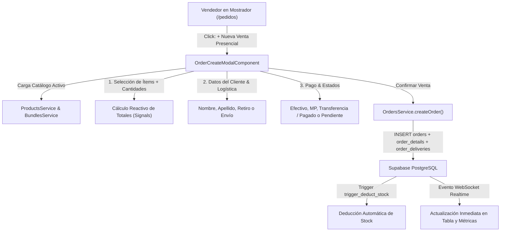

# Plan de Implementación: Creación de Pedidos Presenciales (Venta en Local) en Backoffice

Este plan describe el diseño y la implementación de la funcionalidad de **Creación de Pedidos Presenciales de Mostrador** desde el Backoffice de EcoTanti, permitiendo registrar ventas a clientes no registrados (consumidores finales o presenciales), con soporte para entrega inmediata en local o envío a domicilio.

---

## 1. Arquitectura y Flujo de Datos

---

## 2. Fases de Implementación

### Fase 1: Extensión del Catálogo Compartido (`@ecotanti/shared-catalog`)
1. **Modelos de Entrada (`order.models.ts`):**
   - Definir interfaces fuertemente tipadas:
     - `CreateOrderItemInput` (`item_type`, `product_id`, `bundle_id`, `item_name`, `unit_price`, `quantity`, `subtotal`).
     - `CreateOrderDeliveryInput` (`recipient_name`, `recipient_phone`, `shipping_method`, `shipping_cost`, `address_line`, `city`, `province`, `postal_code`, `notes`).
     - `CreateOrderInput` (`status`, `payment_status`, `payment_method`, `subtotal_amount`, `shipping_cost`, `total_amount`, `notes`, `items`, `delivery`).
2. **Método en `OrdersService` (`orders.service.ts`):**
   - Implementar `createOrder(orderInput: CreateOrderInput): Promise<OrderWithDetails>`:
     - Generación del número de pedido legible con timestamp/secuencia: `ORD-YYYY-XXXXX`.
     - Inserción en `orders` con `user_id: null`.
     - Inserción en lote en `order_details` (activa automáticamente el trigger `trigger_deduct_stock`).
     - Inserción en `order_deliveries`.
     - Retorno de la orden completa creada con sus relaciones.
   - Tests unitarios en `orders.service.spec.ts`.

---

### Fase 2: Componente Modal de Venta Presencial (`OrderCreateModalComponent`)
- **Ubicación:** `projects/backoffice/src/app/features/sales/orders/components/order-create-modal/`
- **Archivos:**
  - `order-create-modal.ts`
  - `order-create-modal.html`
  - `order-create-modal.spec.ts`
- **Estructura Visual de Dos Columnas (Desktop-first y responsivo):**
  1. **Columna Izquierda: Catálogo y Búsqueda Rápida**
     - Buscador por texto con filtrado en tiempo real de productos y combos con stock > 0.
     - Lista scrolleable con miniaturas, nombre, precio unitario y stock disponible.
     - Botón de agregar con 1 clic (`+`).
  2. **Columna Derecha: Canasta y Datos de la Orden**
     - **Ítems seleccionados:** Lista con controles de cantidad `[-] cant [+]`, precio unitario, subtotal y botón de eliminar (`pi pi-trash`).
     - **Datos del Cliente:**
       - Nombre y Apellido (requeridos).
       - Teléfono (opcional, útil para contacto o WhatsApp).
     - **Modalidad de Entrega:**
       - Selector: `Retiro en Local / Mostrador` (por defecto, costo `$0`) vs `Envío a Domicilio`.
       - Si se selecciona envío: se despliegan campos de Dirección, Ciudad y Costo de Envío.
     - **Condiciones de Pago:**
       - Medio de pago: `Efectivo` (default), `Transferencia Bancaria`, `MercadoPago / QR`, `Tarjeta de Débito`, `Tarjeta de Crédito`.
       - Estado de pago: `Pagado` (`completed`, default) o `Pago Pendiente` (`pending`).
       - Estado del pedido: `Entregado` (`delivered`, default si es retiro) o `En Preparación` (`preparing` si es con envío).
     - **Resumen Contable:**
       - Subtotal de productos.
       - Costo de envío (si aplica).
       - **Total a Cobrar**.
     - **Botón de Acción:** *"Confirmar y Registrar Venta"*, deshabilitado si no hay ítems o falta el nombre del cliente.

---

### Fase 3: Integración en la Vista Contenedora (`OrdersComponent`)
1. **Botón en Encabezado ([`orders.html`](file:///d:/Workspace%20-%20Computacion/Workspace%20-%20Personal/Web%20Development/2026/ecotanti/projects/backoffice/src/app/features/sales/orders/orders.html)):**
   - Incorporar botón prominente **`+ Nueva Venta Presencial`** junto al botón de actualizar.
2. **Conexión con el Modal ([`orders.ts`](file:///d:/Workspace%20-%20Computacion/Workspace%20-%20Personal/Web%20Development/2026/ecotanti/projects/backoffice/src/app/features/sales/orders/orders.ts)):**
   - Signal `isCreateModalOpen = signal<boolean>(false)`.
   - Manejador `onOrderCreated(newOrder: OrderWithDetails)`:
     - Muestra Toast de éxito (`MessageService.add({ severity: 'success', summary: 'Venta Registrada', detail: 'Pedido #ORD-XXXX generado exitosamente' })`).
     - Actualiza la lista local de pedidos y recalcula métricas.
     - Abre opcionalmente el drawer de detalle si el usuario desea ver o imprimir el resumen.

---

### Fase 4: Pruebas Unitarias y Verificación
1. **Pruebas en `OrdersService`:**
   - Creación exitosa de orden con inserción transaccional de órdenes, detalles y entrega.
   - Manejo de errores si falla Supabase.
2. **Pruebas en `OrderCreateModalComponent`:**
   - Agregado, modificación de cantidades y remoción de ítems.
   - Cálculo reactivo de totales.
   - Alternancia entre Retiro en Local y Envío a Domicilio.
   - Emisión de evento al registrar la venta.
3. **Pruebas en `OrdersComponent`:**
   - Apertura y cierre del modal de venta presencial.
   - Incorporación de la orden creada a la tabla.
4. **Validación de Compilación y Suites:**
   - `node scripts/run-tests.cjs backoffice`
   - `npm run build:backoffice`

---

## 3. Checklist de Archivos Involucrados

| Archivo | Acción | Descripción |
| :--- | :--- | :--- |
| `libs/shared-catalog/src/lib/models/order.models.ts` | Modificar | Agregar interfaces `CreateOrderInput`, `CreateOrderItemInput`, `CreateOrderDeliveryInput`. |
| `libs/shared-catalog/src/lib/services/orders.service.ts` | Modificar | Implementar método `createOrder()`. |
| `libs/shared-catalog/src/lib/services/orders.service.spec.ts` | Modificar/Crear | Pruebas unitarias del método de creación. |
| `projects/backoffice/src/app/features/sales/orders/components/order-create-modal/order-create-modal.ts` | Crear | Lógica reactiva de selección de ítems, cliente y cobro. |
| `projects/backoffice/src/app/features/sales/orders/components/order-create-modal/order-create-modal.html` | Crear | Plantilla con diseño de dos columnas, catálogo rápido y carrito. |
| `projects/backoffice/src/app/features/sales/orders/components/order-create-modal/order-create-modal.spec.ts` | Crear | Pruebas unitarias completas del modal. |
| `projects/backoffice/src/app/features/sales/orders/orders.ts` | Modificar | Inyectar y abrir el modal desde la vista principal. |
| `projects/backoffice/src/app/features/sales/orders/orders.html` | Modificar | Botón `+ Nueva Venta Presencial` e integración del componente modal. |
| `projects/backoffice/src/app/features/sales/orders/orders.spec.ts` | Modificar | Pruebas de integración del modal en la vista de pedidos. |
